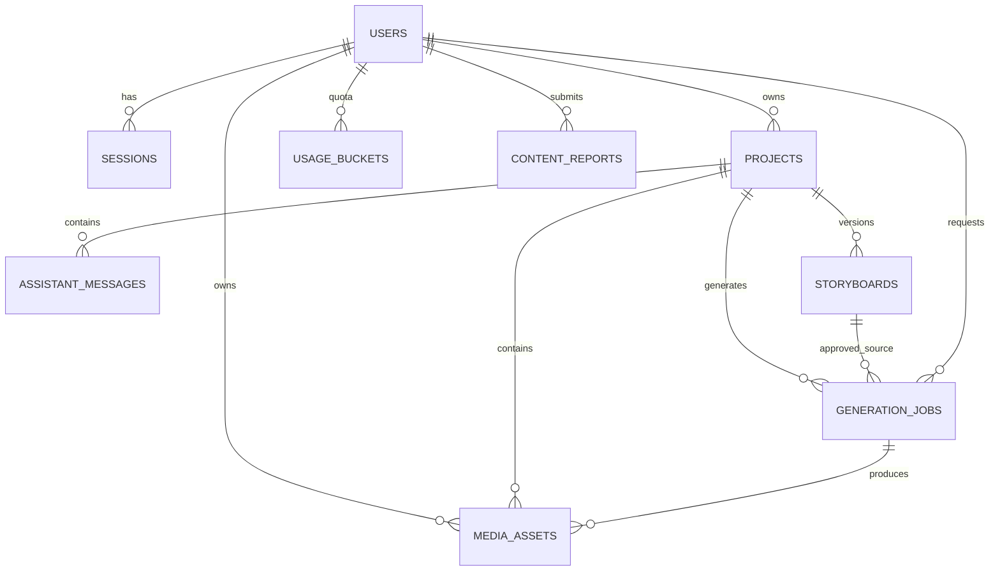

# AI Video Studio — MongoDB Database Design (v1.0)

**Status:** APPROVED database design baseline — 20 November 2026; not implemented.  
**Date:** 18 November 2026  
**Inputs:** Approved PRD v1.0, HLD v1.0, REST API Design v1.0.1 and OpenAPI 3.1.  
**Stack:** Node.js + Express + JavaScript + MongoDB/Mongoose; background Node renderer; Remotion, FFmpeg, Gemini and TTS adapters.  
**Budget:** ₹0 development target; local/Atlas free allowances and storage ceilings must be tested.

## 1. Design goals and key decisions

1. MongoDB holds identity, projects, assistant history, versioned storyboard instructions, jobs, asset **metadata** and usage counters; MP4/WAV/portrait files live in local/object storage, **not** in MongoDB documents.
2. Every user-facing resource has an `ownerId` (ObjectId). API routes filter on both `_id` and `ownerId`; ownership always comes from server-side authentication.
3. One storyboard document is editable while `DRAFT`. `revision` increments atomically on edits. Once `APPROVED`, it is immutable. Editing an approved plan creates another storyboard document with a new ID and a `parentStoryboardId`.
4. A generation job snapshots the exact `storyboardId`, `approvedRevision`, and a stable hash of approved content/settings. Worker must render the approved snapshot, not live mutable project settings.
5. Worker leases, job stages, cancellation, retry links, idempotency and usage reservations are persisted to permit restarts.
6. Client-facing IDs are opaque strings; server resolves/validates against MongoDB IDs. Never trust `ownerId`, `storageKey`, `status` or worker fields supplied by clients.
7. Project deletion immediately revokes access and asynchronously deletes assets. MongoDB TTL is for expiring ephemeral documents, **not** immediate deletion of sensitive media.

## 2. Entity relationship overview



**Reference policy:** MongoDB references are checked in services. No cascading delete at database level; deletion coordinator must remove/revoke dependent data and underlying object-store blobs.

## 3. Collection inventory and fields

Fields in **bold** are required. ObjectIds are internal references; public serializers return opaque `id`. All major records use UTC `createdAt`, `updatedAt` timestamps except explicitly ephemeral documents.

### 3.1 `users`

| Field | Type | Meaning / constraints |
|---|---|---|
| `_id` | ObjectId | Primary key |
| **`displayName`** | String | 2–80 trimmed characters |
| **`emailNormalized`** | String | Lowercased/normalized email; unique |
| **`passwordHash`** | String | Argon2id or bcrypt hash; never select in public responses |
| `role` | String | `USER` (admin separate, not client-settable) |
| `status` | String | `ACTIVE`, `SUSPENDED`, `DELETION_PENDING` |
| `preferences` | Object | Default language, aspect ratio, optional voice style |
| `createdAt`, `updatedAt` | Date | Server timestamps |

Indexes: `{emailNormalized:1}` **unique**; `{status:1,createdAt:-1}` optional for administration. Never store a plaintext password or access JWT.

### 3.2 `sessions`

| Field | Type | Meaning |
|---|---|---|
| **`userId`** | ObjectId | User owner |
| **`tokenHash`** | String | Hash of opaque refresh secret, unique |
| **`familyId`** | String | Refresh token family identifier |
| **`expiresAt`** | Date | Session expiry |
| `rotatedAt`, `revokedAt`, `lastUsedAt` | Date/null | Lifecycle |
| `userAgentHash`, `ipPrefix` | String/null | Minimized security context, retention-limited |
| `createdAt` | Date | Issuance time |

Indexes: `{tokenHash:1}` unique; `{userId:1,revokedAt:1}`; single-field TTL `{expiresAt:1}` with `expireAfterSeconds:0`. Expired records may remain briefly due to MongoDB's asynchronous TTL monitor; authentication must check `expiresAt` itself.

### 3.3 `projects`

| Field | Type | Meaning |
|---|---|---|
| **`ownerId`** | ObjectId | Creator |
| **`title`** | String | 1–120 characters |
| **`prompt`** | String | Validated topic, capped length (proposal 2,000 chars) |
| **`settings`** | Object | Mode, duration, language, ratio, tone, visual style; see below |
| **`phase`** | String | `DRAFT`, `REVIEW`, `RENDERING`, `HAS_OUTPUT` — UI summary only |
| `currentStoryboardId` | ObjectId/null | Currently selected draft/approved plan |
| `activeGenerationId` | ObjectId/null | UI pointer, not sole concurrency authority |
| `latestGenerationId` | ObjectId/null | Latest attempt |
| `latestOutputAssetId` | ObjectId/null | Most recent **successful** output; retain on failed retry |
| `deletedAt` | Date/null | Tombstone; immediately hide and revoke access |
| `createdAt`, `updatedAt` | Date | Timestamps |

`settings` example:

```json
{
  "mode": "FACELESS",
  "durationSec": 60,
  "language": "en",
  "aspectRatio": "16:9",
  "tone": "EDUCATIONAL",
  "visualStyle": "MOTION_GRAPHICS",
  "characterAssetId": null
}
```

Enumerations are checked against the `/capabilities` availability and server-side allowlist. Indexes: `{ownerId:1,deletedAt:1,updatedAt:-1,_id:-1}` for keyset project listing, `{ownerId:1,_id:1}` for owned lookups. Service blocks modifications that conflict with active approved snapshot; never overwrite completed output on retry failure.

### 3.4 `assistantMessages`

| Field | Type | Meaning |
|---|---|---|
| **`ownerId`**, **`projectId`** | ObjectId | Ownership and conversation scope |
| **`role`** | String | `USER` or `ASSISTANT` |
| **`content`** | String | Bounded text; sanitize and avoid secrets |
| `suggestedSettings` | Object/null | Suggestions only, not auto-accepted changes |
| **`conversationRevision`** | Number | Monotonic project-level sequence, allocated atomically |
| `createdAt` | Date | Ordered transcript time |

Index: `{projectId:1,conversationRevision:1}` unique; `{ownerId:1,projectId:1,createdAt:-1}`. To ensure a single monotonic revision on parallel assistant requests, use an atomic counter on the owning project or a transactional allocator. Cap history passed to Gemini and document retention/privacy controls.

**API mapping:** The approved `GET /api/v1/projects/{projectId}/assistant/messages` reads this collection in ascending `conversationRevision` order with an opaque cursor and owner-scoped project check. Never expose prompt-internal context or provider credentials.

### 3.5 `storyboards`

| Field | Type | Meaning |
|---|---|---|
| **`ownerId`, `projectId`** | ObjectId | Scope |
| **`status`** | String | `DRAFT`, `APPROVED` |
| **`revision`** | Integer | Starts at 1; draft edits increment via compare-and-set |
| `parentStoryboardId` | ObjectId/null | Version lineage when forking |
| **`schemaVersion`** | Integer | Scene-data validator version |
| **`targetDurationSec`** | Integer | 30/60/90 target |
| **`settingsSnapshot`** | Object | Mode, language, ratio, style and character asset at planning time |
| **`scenes`** | Array | Bounded ordered scene specs |
| `approvedAt` | Date/null | Frozen after approval |
| `contentHash` | String | SHA-256 of canonical approved plan + settings, computed by server |
| `createdAt`, `updatedAt` | Date | Timestamps |

Each scene has `sceneId`, `template` (allowlist such as `TITLE`, `STEPS`, `STACK_QUEUE`, `FLOWCHART`, `COMPARISON`, `TIMELINE`, `KEY_POINTS`, `IMAGE_WITH_LABELS`, `CHARACTER_PRESENTER_2D`), `narration`, `visualProps` **validated per template**, `estimatedDurationSec`, optional `assetIds`. Enforce scene count bounds, string caps, no generated executable code or arbitrary external URLs. This embedded scene array fits the small 30–90-second plans; split into another collection only after size/feature pressure justifies it.

Indexes: `{ownerId:1,projectId:1,createdAt:-1}`; `{projectId:1,status:1}`. All updates to draft require filter `{_id,ownerId,status:'DRAFT',revision:expectedRevision}` and `$inc:{revision:1}`. After approval, never mutate this document. The server **must** enforce immutability in service/model middleware rather than relying only on UI.

### 3.6 `generationJobs`

| Field | Type | Meaning |
|---|---|---|
| **`ownerId`, `projectId`, `storyboardId`** | ObjectId | References |
| **`approvedRevision`** | Number | Exact approved revision |
| **`storyboardHash`** | String | Frozen input digest; worker checks |
| **`status`** | String | `QUEUED`, `PROCESSING`, `CANCEL_REQUESTED`, `COMPLETED`, `FAILED`, `CANCELLED` |
| `stage` | String/null | `PREPARE_ASSETS`, `SYNTHESIZE_AUDIO`, `ALIGN_TIMELINE`, `RENDER_VIDEO`, `VALIDATE_OUTPUT`, `UPLOAD_OUTPUT` |
| `progress` | Object | `completedStages`, `totalStages` only; no fake percentage |
| **`idempotencyKeyHash`** | String | Hash scoped to current user and API action |
| **`requestHash`** | String | Canonical request body digest; mismatch returns `409` |
| **`action`** | String | `START` or `RETRY` |
| `retryOf` | ObjectId/null | Links failed/cancelled attempt |
| **`attempt`** | Number | Starts 0, bounded retry attempts |
| `lease` | Object/null | `{workerId, fencingToken, expiresAt, heartbeatAt}` |
| `cancelRequestedAt` | Date/null | Cooperative cancellation |
| `outputAssetId` | ObjectId/null | Only set after validated successful export |
| `error` | Object/null | Sanitized `{code,message,retryable}` |
| `startedAt`, `completedAt`, `createdAt`, `updatedAt` | Date/null | Lifecycle |

**Indexes:**

```js
// Build with Mongoose schema.index() and migration/bootstrap review.
{ownerId: 1, projectId: 1, createdAt: -1, _id: -1} // history
{status: 1, 'lease.expiresAt': 1, createdAt: 1}     // claim/recovery
{ownerId: 1, action: 1, idempotencyKeyHash: 1}     // unique
{projectId: 1}                                    // unique PARTIAL for active states
```

For the partial unique index, use `partialFilterExpression` with allowed active states (`QUEUED`, `PROCESSING`, `CANCEL_REQUESTED`) after testing MongoDB server compatibility. This is the **database concurrency guard** for at most one active job per project; the pointer in `projects` alone is not adequate. Guard quota reservation and job insert atomically with a transaction where supported; otherwise build retry-safe reconciliation. Idempotency records must remain for the agreed retry window (proposed 24h) and should not be erased while clients can replay a key.

**Claiming jobs:** Atomically `findOneAndUpdate` an eligible queued job with `status:'PROCESSING'`, new lease token and expiration. For an expired processing lease, only reclaim with a capped attempt count; previous worker writes are rejected by `fencingToken` checks. Use a unique per-attempt temp output path and verify lease ownership before final publication. Never let a stale worker mark a duplicate `COMPLETED`. Heartbeats extend leases; worker shutdown/timeout releases safely.

**Cancellation:** request sets `CANCEL_REQUESTED` in DB; rendering worker checks it, stops cooperatively, and records `CANCELLED` only after the process actually stops. For an already terminal job return a state conflict. `FAILED`/`CANCELLED` retry creates a **new** job pointing at original snapshot, preserving history.

### 3.7 `mediaAssets`

| Field | Type | Meaning |
|---|---|---|
| **`ownerId`** | ObjectId | Owner, checked on all read/download/delete |
| `projectId`, `generationId` | ObjectId/null | Owning project/job |
| **`kind`** | String | `CHARACTER_IMAGE`, `NARRATION_AUDIO`, `VIDEO_EXPORT`, optional `THUMBNAIL` |
| **`storage`** | Object | `{provider: 'LOCAL'|'OBJECT', key, region?}`; never public signed URL |
| **`mimeType`, `sizeBytes`** | String, Number | Detected/verified media metadata |
| **`status`** | String | `UPLOADING`, `READY`, `DELETING`, `DELETED`, `FAILED` |
| `sha256`, `durationSec`, `width`, `height` | Values | Verified metadata, depending on kind |
| **`aiGenerated`** | Boolean | Synthesized output disclosure |
| `consent` | Object/null | For identifiable characters: attested, timestamp, declared rights; no claim attestation equals proven consent |
| `retentionUntil`, `deletedAt` | Date/null | Cleanup scheduling |
| `createdAt`, `updatedAt` | Date | Timestamps |

Indexes: `{ownerId:1,projectId:1,createdAt:-1}`; `{generationId:1,kind:1}`; `{ 'storage.provider':1,'storage.key':1}` unique when storage key present. **Do not TTL-delete asset metadata while its blob remains**: first revoke access, delete remote object/local file, and persist deletion outcome (or keep a minimal audit tombstone). Download resolves private local stream or short-lived signed object URL after auth; avoid public permanent portrait URLs.

### 3.8 `usageBuckets` (small MVP quota collection)

| Field | Type | Meaning |
|---|---|---|
| **`userId`, `periodStart`** | ObjectId, Date | UTC daily bucket |
| **`limit`** | Number | Configured allowance, not a guaranteed free plan |
| **`reserved`**, **`consumed`** | Number | Concurrency/usage accounting |
| `updatedAt` | Date | Timestamp |

Unique `{userId:1,periodStart:1}`. Reserve only when capacity is available and one job can be admitted. Deduplicated retry should not reserve twice. Refund/consume policy must be documented by product and reconciled after worker failures. Avoid TTL until record retention/auditing policy is defined.

### 3.9 `contentReports` (moderation/reporting)

Fields: `reporterId`, `ownerId` (optional if report about the reporter's resource), `assetId`/`projectId`, `reasonCode`, bounded `description`, `status: OPEN|REVIEWED|RESOLVED`, `createdAt`, `resolvedAt`. Index `{status:1,createdAt:1}`, `{reporterId:1,createdAt:-1}`. Never expose all reports through public APIs.

### 3.10 `workerHeartbeats` (lightweight optional availability records)

Fields: `workerId`, `lastSeenAt`, `availableSlots`, `capabilities`, `expiresAt` (date). Index `{expiresAt:1}` TTL (non-authoritative). API `/capabilities` considers `lastSeenAt` and current queue caps instead of relying on TTL deletion timing. Avoid exposing internal worker host/path data.

## 4. End-to-end consistency: approved plan to export

1. **Create project**: owner from JWT session; safe default settings.
2. **Chat**: bounded messages, suggested settings saved to message; `PATCH /projects` explicitly accepts suggestions.
3. **Generate storyboard**: Gemini JSON → validate schema and allowed templates → `storyboards DRAFT`. Save `currentStoryboardId` on project.
4. **Edit draft**: optimistic CAS with `expectedRevision`; returning `409 REVISION_CONFLICT` if stale.
5. **Approve**: CAS `DRAFT → APPROVED`, freeze `contentHash`. A new edit must fork a new document.
6. **Start generation**: verify same owner/project, approved revision and hash, worker availability, quota; idempotency key; create `QUEUED` job. Enforce one-active-per-project via partial unique index; transaction or compensating reconciliation for bucket+job writes.
7. **Worker**: atomic claim/lease; process scene-level TTS, align durations, Remotion render; FFprobe verify tracks, duration tolerance and no clipped narration; upload; persist READY asset; then mark job COMPLETED and update `projects.latestOutputAssetId` with a fenced, guarded write.
8. **Result**: RTK Query polls by `generationId`; backend owner-scopes. `GET /assets/:id/download` auth-checks then streams/redirects with short expiry.
9. **Retry**: new job for the same immutable storyboard snapshot and new idempotency key; prior output never silently disappears.
10. **Delete**: set `deletedAt`, deny reads immediately, cancel queued/active jobs, revoke URLs, schedule storage and metadata cleanup; protect against worker writing after delete with final owner/project state checks.

## 5. Suggested Mongoose schema and index snippets (illustrative, illustrative implementation guidance)

```js
import mongoose from 'mongoose';
const { Schema } = mongoose;

const ProjectSchema = new Schema({
  ownerId: { type: Schema.Types.ObjectId, ref: 'User', required: true },
  title: { type: String, required: true, trim: true, maxlength: 120 },
  prompt: { type: String, required: true, maxlength: 2000 },
  settings: {
    mode: { type: String, enum: ['FACELESS', 'CHARACTER_2D'], default: 'FACELESS' },
    durationSec: { type: Number, enum: [30, 60, 90], required: true },
    language: { type: String, enum: ['en', 'hi'], default: 'en' },
    aspectRatio: { type: String, enum: ['16:9', '9:16'], default: '16:9' },
    characterAssetId: { type: Schema.Types.ObjectId, ref: 'MediaAsset', default: null }
  },
  phase: { type: String, enum: ['DRAFT','REVIEW','RENDERING','HAS_OUTPUT'], default: 'DRAFT' },
  currentStoryboardId: { type: Schema.Types.ObjectId, ref: 'Storyboard', default: null },
  latestOutputAssetId: { type: Schema.Types.ObjectId, ref: 'MediaAsset', default: null },
  deletedAt: { type: Date, default: null }
}, { timestamps: true });
ProjectSchema.index({ ownerId: 1, deletedAt: 1, updatedAt: -1, _id: -1 });

const SessionSchema = new Schema({
  userId: { type: Schema.Types.ObjectId, required: true, ref: 'User' },
  tokenHash: { type: String, required: true, unique: true },
  expiresAt: { type: Date, required: true },
  revokedAt: { type: Date, default: null }
}, { timestamps: true });
SessionSchema.index({ expiresAt: 1 }, { expireAfterSeconds: 0 });

const GenerationJobSchema = new Schema({
  ownerId: { type: Schema.Types.ObjectId, required: true },
  projectId: { type: Schema.Types.ObjectId, required: true },
  storyboardId: { type: Schema.Types.ObjectId, required: true },
  approvedRevision: { type: Number, required: true },
  status: { type: String, required: true,
    enum: ['QUEUED','PROCESSING','CANCEL_REQUESTED','COMPLETED','FAILED','CANCELLED'] },
  action: { type: String, enum: ['START','RETRY'], required: true },
  idempotencyKeyHash: { type: String, required: true },
  requestHash: { type: String, required: true },
  lease: { workerId: String, fencingToken: String, expiresAt: Date, heartbeatAt: Date }
}, { timestamps: true });
GenerationJobSchema.index({ ownerId: 1, action: 1, idempotencyKeyHash: 1 }, { unique: true });
GenerationJobSchema.index({ projectId: 1 }, {
  unique: true,
  partialFilterExpression: { status: { $in: ['QUEUED','PROCESSING','CANCEL_REQUESTED'] } }
});
GenerationJobSchema.index({ status: 1, 'lease.expiresAt': 1, createdAt: 1 });
```

Do not copy snippets without completing validators, defaults, owned resource checks, indexes and workers. Public serializers should never expose hashes, leases or storage keys.

## 6. Data governance, privacy, and retention

- **PII:** Keep only necessary account data, hash credentials, redact sensitive logs. Separate consent declarations from AI output claims.
- **Portraits:** Rights attestation required for identifiable people; moderation and abuse report route. Uploaded photos remain private, with user-initiated deletion and disclosed retention. Re-encode images/strip EXIF where possible.
- **Retention (proposals to approve):** signed URLs ≤60s; temp render files clean up after upload/validation; assistant chat history bounded; generated output retained until project deletion or published policy; session documents expire with TTL.
- **Project deletion:** soft-delete first, revoke access, schedule physical assets cleanup and remove personal records according to retention/legal policy. Assets cannot be left publicly accessible after deletion.
- **Atlas/storage limits:** load/size tests required; a MongoDB free tier is not unlimited. Monitor job count, index footprint and media size. Storage provider selection remains open.

## 7. Key DB acceptance tests for Codex

| Test | Expected result |
|---|---|
| Two users request same project ID | Non-owner receives 404; cannot access assets/jobs |
| Simultaneous draft edits with revision 1 | One succeeds, another receives 409 |
| Render requested for unapproved storyboard | 409; no job created |
| Same idempotency key + body repeated | Exactly one job returned |
| Same key + different body | 409; no extra job |
| Concurrent render requests same project | One active job, others 409; unique gate holds |
| Worker dies after claiming job | Lease expires; bounded reclaim safely resumes/fails |
| Old worker wakes after lease replacement | Fencing check prevents stale COMPLETED publish |
| User deletes project during rendering | Access revoked immediately; worker cannot publish final media |
| Output upload fails | Job FAILED; no phantom completed asset |
| TTS exceeds requested time | Revision path rather than cutting narration |
| Session TTL has not fired yet | Auth rejects expired token anyway |
| Usage reservation conflict | At most allowed capacity; reservations eventually reconciled |

## 8. Mapping to API / PRD and open decisions

| API group | Collections |
|---|---|
| `/auth/*` | `users`, `sessions` |
| `/projects/*` | `projects`, `assistantMessages`, `storyboards`, `generationJobs`, `mediaAssets` |
| `/assistant/messages` | `assistantMessages`, `projects` |
| `/storyboards/*` (nested under projects) | `storyboards`, `projects` |
| `/generations/*` | `generationJobs`, `storyboards`, `mediaAssets`, `usageBuckets` |
| `/assets/*` | `mediaAssets` + storage provider |
| `/usage`, `/capabilities` | `usageBuckets`, `workerHeartbeats`, config |
| `/reports` | `contentReports` |

**Open before implementation:** Production object storage provider, exact limits, Hindi/vertical feature flags, project/media retention durations, worker lease timeout/retry budget, actual prototype code audit, billing model beyond MVP, exact job quota accounting under transaction/restart, and moderation operations.

**Next deliverable:** UI/UX specification and responsive prototype, then review these contracts for sign-off before Codex implementation.

**Primary references:** PRD v1.0; HLD v1.0; REST API Design v1.0; MongoDB documentation for TTL indexes, partial indexes and `findOneAndUpdate` atomic operations.


---

**Design-baseline approval:** 20 November 2026. Approved for Codex implementation and testing; unverified provider quotas, deployment limits and model behavior remain explicit engineering risks.
