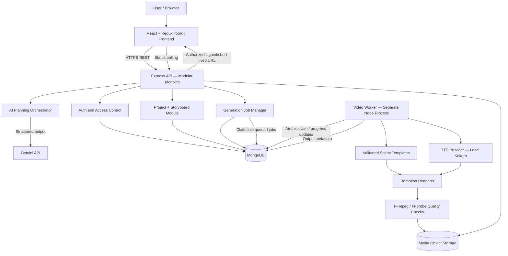
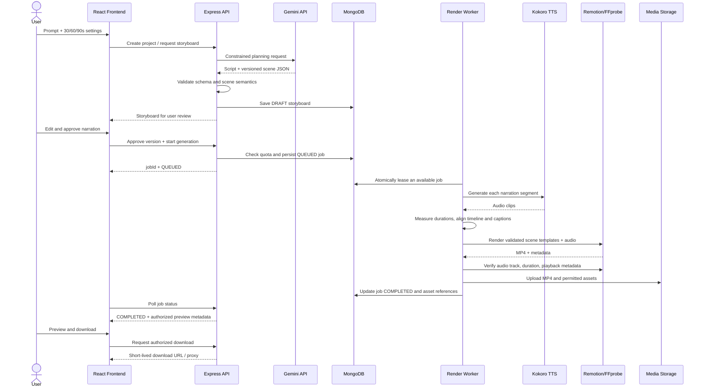

# AI Video Studio — System Design and High-Level Architecture (HLD)

**Version:** 1.0 — APPROVED architecture baseline (20 November 2026)  
**Date:** 18 November 2026  
**Source of requirements:** Approved AI Video Studio PRD v1.0  
**Design approach:** Modular MERN backend + isolated asynchronous video worker  
**Language choice:** JavaScript for React, Redux Toolkit, Node/Express, Mongoose, and Remotion  
**Budget:** ₹0 development/prototype constraint; no promise of zero-cost unlimited production infrastructure

## 1. Purpose and design boundaries

AI Video Studio converts a natural-language prompt into a 30-, 60- or 90-second animated explainer with an approved script, storyboard, synthetic narration, synchronized graphics/captions and an MP4 download. It also plans a **P1 gated** Custom Character mode: an authorized uploaded image used as a simple 2D visual presenter. Realistic lip sync and voice cloning are out of the initial scope.

**Architecture goals**
- Enable the complete idea-first experience: sign in → chat/choose settings → generate draft → approve → render → preview/edit → download.
- Make the generation engine **data-driven**, reusing React/Remotion scene templates rather than generating executable source code.
- Separate fast APIs from CPU/GPU intensive generation jobs, persist progress, and recover from interrupted jobs.
- Keep owner-level access control, consent and clear AI-disclosure for user uploads.
- Develop/test on an ASUS Zenbook with 16 GB RAM and Intel Arc graphics; avoid requirements for paid APIs or an NVIDIA-only renderer.
- Retain replaceable integration boundaries for LLM, TTS, storage and future rendering infrastructure.

**Non-goals:** unrestricted photorealistic text-to-video, 90-second end-to-end zero-latency generation, multi-tenant unlimited free concurrency, full professional editor, realistic real-person lip sync, voice cloning, and payments in v1.

## 2. Technology decisions

| Layer | Proposed implementation | Rationale / status |
| --- | --- | --- |
| Frontend | React.js + JavaScript + Vite + Redux Toolkit + RTK Query + Tailwind CSS | User-selected stack; RTK Query for API caching, slices for editor/creation UI |
| Backend/API | Node.js + Express.js + JavaScript (ES modules) | User-selected MERN technology; modular monolith |
| Data | MongoDB + Mongoose | Project, user, storyboard, asset metadata and job lifecycle; not binary video storage |
| Authentication | First-party auth: salted password hashing, short-lived JWT, rotated refresh-token sessions in httpOnly cookies | Familiar to the user, avoids an additional auth provider; details in API/security design |
| AI planning | Google Gemini API with structured JSON output | Prompt interpretation, narration, storyboard and constrained scene specs; free availability must be re-verified for selected model |
| Narration | Kokoro local TTS, behind `SpeechProvider` abstraction; optional cloud-provider adapter | No per-request local API cost; validate voice quality, speed and language support |
| Visual rendering | React/SVG/CSS + Remotion compositions | Reusable diagram/infographic scene templates, driven by validated JSON |
| Rendering and inspection | Remotion Node renderer + FFmpeg/FFprobe | MP4 composition, optional audio operations, media validation |
| Asynchronous work | Dedicated Node worker process, MongoDB-backed job queue with claim/lease, 1 render concurrently on laptop | No Redis required at the beginning; replaceable later by Redis/BullMQ |
| Media storage | Storage adapter, initially filesystem for local POC; limited object storage (e.g., Cloudinary) for remote demo | Store files outside MongoDB; enforce authenticated access and retention |
| Infrastructure | Static frontend host; limited/free Node API; local always-on-only-during-demo worker | Free API web services often sleep, and do not provide reliable heavy background rendering |

**Not locked until validation:** exact Gemini model/free quotas, cloud TTS fallback, storage provider/access mode, production worker host, spoken Hindi quality, and reusable components in the user-reported working Codex prototype.

## 3. High-level component diagram



**Boundaries:** The worker is a different *process* executing the same application's owned workflows, not a fully autonomous microservice. Frontend never receives API keys, DB credentials, raw worker commands, or private storage credentials.

## 4. Frontend responsibilities and state

**Screens:** landing/auth; dashboard + AI assistant; new-video settings; script/storyboard review; progress; preview/limited edit; project library; account/privacy/upload-consent controls.

- **RTK Query:** calls, API loading/cache, current user, projects list, project detail, generation-job status (polling while active).
- **Redux slices:** creation-wizard choices, current unsaved script editor draft, timeline preview UI, optional modal/toast state.
- **Local component state:** small transient form state.
- **Server source of truth:** ownership, accepted storyboard version, job state, quota, asset URLs/visibility and final exported media.
- **Never:** put API secrets in React; claim a job is completed based on local timeout; assume access to a video URL bypasses server authorization.

Use a simple REST interface and periodic status polling at first. SSE or WebSockets are optional later, not necessary for MVP.

## 5. Express modular monolith modules

1. **Auth:** registration/login/logout/session renewal, password hashing, session revocation, cookie/CORS/CSRF configuration.
2. **Projects:** create/retrieve/update/delete only owner-owned projects; versions of script and storyboard; project library.
3. **Assistant/AI Planning:** validate prompt, moderation, Gemini structured generation, budget/token controls, schema validation, retries, provider errors.
4. **Storyboards:** script editing and approved version locking; visual templates, duration estimates and scene ordering.
5. **Generation Jobs:** admit requests only if capacity/quota allows; create jobs idempotently; publish/cancel/failed state.
6. **Media Assets:** controlled upload/download, image validation, rights attestation, storage provider, cleanup.
7. **Usage & Limits:** per-account/request limits, local worker availability, generation quotas, at-most-one active render initially.
8. **Observability:** request IDs, job/stage logs, elapsed processing time, errors and resource utilization without logging private uploads by default.

Controllers stay thin; business logic in services, models/repositories persist data, provider adapters isolate external APIs.

## 6. End-to-end interaction sequence



**Critical detail:** Script approval precedes expensive generation. Audio is produced **per scene**, measured, and used to calculate a coherent shared timeline. If speech exceeds the requested video duration, the job should stop for approved revision or use explicit policy for re-timing—never silently truncate the narration.

## 7. AI storyboarding contract

Gemini should output **data, never dynamically executable React/JavaScript source**. The API validates all fields and whitelists scene types before persistence/rendering.

```json
{
  "schemaVersion": 1,
  "projectId": "projectId-from-server",
  "targetDurationSec": 60,
  "language": "en",
  "aspectRatio": "16:9",
  "mode": "FACELESS",
  "scenes": [
    {
      "sceneId": "scene-001",
      "template": "STACK_QUEUE",
      "narration": "JavaScript executes synchronous functions on a call stack.",
      "visualProps": {
        "title": "The Call Stack",
        "items": ["main()", "calculate()"]
      },
      "estimatedDurationSec": 8
    }
  ]
}
```

This is an illustrative **fragment**, not a complete validated 60-second storyboard; one scene cannot satisfy the whole target. In the actual JSON contract, derive `projectId` on the server; never trust model-supplied identifiers or asset paths. Limit scene counts, text lengths, visual types, media origins and total duration. Use a versioned schema validator (such as Zod or Ajv). Do not evaluate generated code, shell commands or arbitrary render props.

**Initial reusable templates:** TITLE, STEPS, STACK_QUEUE, FLOWCHART, COMPARISON, TIMELINE, KEY_POINTS, IMAGE_WITH_LABELS, CHARACTER_PRESENTER_2D. Where there is no safe accurate template, fall back to clearly labeled text/illustration rather than inventing unsupported factual diagrams.

## 8. Audio, visual and caption pipeline

**Planning:** prompt → script/scene plan → validation → user approval.  
**Narration:** approved scene text → `SpeechProvider.synthesize(sceneText, voice)` → audio segments → `ffprobe` measured durations.  
**Timeline:** compute start frame and duration from measured audio + planned pauses; use a single canonical timing map for scene animations, audio and captions.  
**Captions:** start with narration-segment/sentence timing; word-level highlighting requires a proper alignment method later.  
**Visuals:** scene template lookup from a strict allowlist; props validated and text overflow checked; 2D character composited only for authorized uploads.  
**Export:** Remotion Node renderer writes H.264/AAC MP4 target if supported, then FFprobe verifies decodable tracks, duration and dimensions.  
**Persistence:** store intermediate and exported media in temporary local workspace/object storage, with asset metadata in MongoDB. Clean up generated files after confirmation and retention period.

**Target:** presets 30/60/90 seconds; initial tolerance ±5 seconds; no speech clipping. Test 1280×720, 30fps before increasing resolution. For small runtimes, avoid unnecessary audio compression/transcoding.

## 9. Job state, scheduling and reliability

**Top-level states:** `DRAFT` (project/storyboard) → `QUEUED` → `PROCESSING` → `COMPLETED` or `FAILED` / `CANCELLED`.

**Processing stages:** `PREPARE_ASSETS`, `SYNTHESIZE_AUDIO`, `ALIGN_TIMELINE`, `RENDER_VIDEO`, `VALIDATE_OUTPUT`, `UPLOAD_OUTPUT`.

A dedicated **Node worker** polls a `generationJobs` collection. It **atomically** claims a queued job using `findOneAndUpdate` with a lease expiration and worker identity. It renews the lease during progress, and an expired lease can be reclaimed with controlled retries. A single concurrency slot is recommended for the user's 16 GB laptop, then benchmark.

- Use a submission idempotency key to avoid duplicate jobs from double-clicks/retries.
- Make each processing stage retry-safe; validate/rename/upload output exactly once per job/version, or deduplicate by an immutable key.
- Persist progress stage, timestamps, attempt count and sanitized last error.
- On provider quota exhaustion or offline worker, reject/hold new work with truthful availability messaging; do not silently grow an unbounded queue.
- Treat failures honestly: broken/corrupt MP4 is never `COMPLETED`; accepted project/script survives to allow resubmission.
- Separate transient local files from durable project/media records.

Mongo-backed job leasing is sufficient for low-volume MVP. Reevaluate Redis/BullMQ if multiple workers, high queue volume, scheduling/monitoring and throughput justify it.

## 10. Data collection architecture (details in approved Database Design v1.0)

| Collection | Core responsibility |
| --- | --- |
| `users` | Identity, hashed credentials, profile/limits |
| `sessions` | Hashed refresh-token/session identifiers and revocation |
| `projects` | Owner, creation choices, mode, lifecycle, current approved revision |
| `storyboards` | Versioned narration, scene plan, scene templates, approval status |
| `generationJobs` | Submission idempotency key, status, lease, attempts, progress and errors |
| `mediaAssets` | Object-store key, owner, type, lifecycle, retention and consent metadata |
| `usageBuckets` | Quota accounting, admission control and audit of capacity |

Store **media references**, not multi-megabyte MP4 or WAV files, in MongoDB. Owners are checked in API queries and access to assets must be authorized. Formal field schema, validation, relationships and indexes are postponed to Database Design.

## 11. API groups (detailed contracts in approved API Design v1.0.1)

- `/api/v1/auth/*` — account/session functions
- `/api/v1/projects/*` — project lifecycle and ownership
- `POST /api/v1/assistant/messages` and `GET /api/v1/projects/{projectId}/assistant/messages` — conversational intake and paginated history
- `/api/v1/storyboards/*` — draft revision and approval
- `/api/v1/generations/*` — start/status/cancel/retry
- `/api/v1/assets/*` — upload, metadata, deletion, authorized download
- `/api/v1/usage/*` — quota/capacity display

Exact HTTP methods, bodies, response codes, pagination and request IDs will be fixed in the next **API Design** phase.

## 12. Security, content safety and privacy

- Passwords salted+hashed (e.g. argon2id or bcrypt); short-lived sessions, securely stored/rotated refresh tokens, httpOnly secure cookies, tailored SameSite/CSRF protection and strict CORS origin allowlist.
- Server always verifies asset/project ownership; never trust userId supplied by the client.
- Server-side rate limits, prompt size caps, duration limits, upload size/type/magic-byte checks, decoding safety and MIME checks.
- No secrets in Redux or browser; no generated code `eval`, unrestricted file paths or child-process commands derived from AI output.
- Require explicit rights/consent confirmation for identifiable uploads, AI-generated disclosure, deletion/retention mechanism and an abuse-report process.
- Minimize what is forwarded to external providers, particularly sensitive user images and prompts; publish real provider data-handling disclosures before public release.
- Protect storage media with private access or short-lived signed delivery, not permanent public object URLs for personal uploads.
- Apply prompt/upload and output policies; script review is a user control, not a guarantee of factual accuracy.

## 13. Deployment and zero-cost feasibility

**Local development:** React Vite frontend + Express API + local MongoDB or Atlas Free + local Node worker + local Kokoro + Remotion/FFmpeg; local temp storage. The user has reported that Codex already produced a good audio/video prototype, but its actual dependencies and exported media still need review.

**Limited remote demo:** static frontend host + limited free API host + Atlas Free + tightly capped media-object storage + the developer's own machine as available render worker. A local worker must connect securely to the shared database/storage or a task gateway; do **not** expose a local unauthenticated port or database to the internet. The demo can truthfully show `worker offline`/`rendering temporarily unavailable` when the laptop is off.

Free Render web services may spin down after 15 minutes of inactivity and have ephemeral disks, so they are **not** reliable for long-running FFmpeg/Remotion jobs. Free database/storage tiers also have limits. A permanently available concurrent consumer SaaS is **not** proven to be free.

**Future capacity path:** managed durable job queue + dedicated renderer/GPU or CPU worker + scalable object storage + metrics and cost enforcement. Not required in MVP.

## 14. Decisions, open questions and architecture review gates

**Accepted architecture decisions for V1:**
1. User-selected React/Redux Toolkit/JS + Express/Node/JS + MongoDB/Mongoose.
2. Modular backend monolith with a **separate rendering process** and a **MongoDB-backed queue** initially.
3. Gemini for constrained script/storyboard generation; provider adapter for TTS with Kokoro local as an initial candidate.
4. Reuse Remotion + React/SVG templates, disallow arbitrary model-authored code execution.
5. Media stored in object storage, metadata stored in MongoDB; no large binaries in documents.
6. Poll generation status, avoid WebSockets/Redis/microservices until justified.
7. Local worker permitted for ₹0 portfolio demonstration; publicly hosted always-on rendering is an unresolved cost problem.

**Validation still needed before design freeze:**
- Audit the actual audio/video Codex prototype (`package.json`, render entry point, audio source, MP4/FFprobe output, measured time/memory).
- Confirm available Gemini model and quota, TTS models and Hindi/English quality; ensure no private image is unintentionally sent to third parties.
- Benchmark 30/60/90 seconds locally including high-load conditions, memory consumption, captions and export quality.
- Select storage provider/access model and document retention periods.
- Test worker claim/lease/restart and failure recovery.
- Select precise security/cookie deployment configuration.
- Validate on at least one Chrome/Edge browser and mobile preview.

## 15. Mapping to next SDLC phases

1. **HLD approved** against the PRD; implementation/POC audit checks remain engineering tasks.
2. **API Design:** finalize endpoint methods, auth, request/response schemas, errors, status polling and idempotency.
3. **Database Design:** Mongoose schemas, cardinalities, indexes, TTL/retention, lease queries and ownership constraints.
4. **UI/UX:** design chat/dashboard, script editor, generation progress, preview/export and upload-consent flows.
5. **Codex implementation:** initialize repository with documents as instructions, code feature-by-feature, tests and review.
6. **QA & deployment:** validate P0 launch scenarios, privacy, media integrity, capacity limitation and truthful public demo claims.

## 16. Primary official reference URLs (checked November 2026)

- Remotion: https://www.remotion.dev/docs/passing-props
- Gemini API structured output: https://ai.google.dev/gemini-api/docs/structured-output
- Gemini pricing and free models: https://ai.google.dev/gemini-api/docs/pricing
- Kokoro model/license: https://huggingface.co/hexgrad/Kokoro-82M
- MongoDB Atlas free-tier limits: https://www.mongodb.com/docs/atlas/reference/free-shared-limitations/
- Render free hosting and ephemeral storage: https://render.com/docs/free
- Cloudinary pricing: https://cloudinary.com/pricing

---

**Review status:** APPROVED HLD baseline for implementation (20 November 2026). Provider quotas and public infrastructure remain unverified and must be tested; design approval is not production certification. This file is designed to live under `docs/system-design/AI_Video_Studio_HLD_v1.0.md`.


---

**Design-baseline approval:** 20 November 2026. Approved for Codex implementation and testing; unverified provider quotas, deployment limits and model behavior remain explicit engineering risks.
