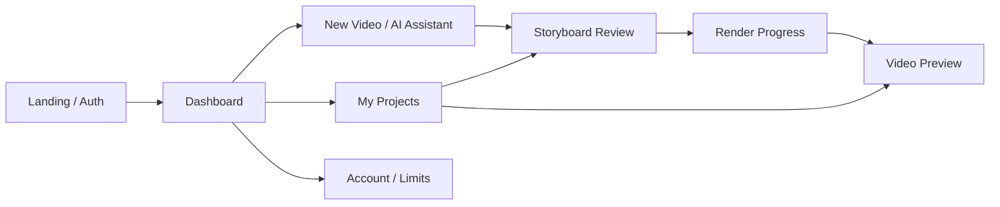

# AI Video Studio — UI/UX Design Specification (v1.0)

**Status:** APPROVED UI/UX design baseline — 20 November 2026; static prototype only, implementation pending.  
**Date:** 18 November 2026  
**Inputs:** Approved PRD, HLD, API Design v1.0.1 and MongoDB Design v1.0.  
**Stack:** React + Redux Toolkit / RTK Query + JavaScript + Tailwind CSS.  
**Design aesthetic:** Quiet cinematic workspace — dark charcoal, typography-led, understated cool sage accents, not neon, not oversaturated.

## 1. Design concept and why it fits this product

The application serves beginners generating 30/60/90-second narrated explainer videos. The first screen must ask **what should we create?**, not overwhelm the user with timelines, credit charts or dozens of tools. Visuals should suggest a professional editing suite while the flow remains easy and conversational.

- **Personality:** Confident, focused, cinematic, human, polished, calm.
- **Emphasis:** Content and writing before controls; meaningful animation without visual noise.
- **Promise:** Prompt → guided settings → AI script/storyboard → approve → background render → preview/download.
- **Progressive disclosure:** Only show extra options (character upload, advanced settings) if selected and supported.
- **Honest capabilities:** `/capabilities` controls availability; do not present beta portrait mode, Hindi voices or vertical renders as live until tested.

## 2. Design tokens

| Token | Hex / value | Usage |
|---|---|---|
| `bg.canvas` | `#0C1114` | Page canvas |
| `bg.sidebar` | `#10171A` | Left navigation |
| `bg.surface` | `#151D21` | Panels/cards |
| `bg.elevated` | `#1D282C` | Inputs, hover, raised panels |
| `border.subtle` | `#2A3639` | Hairline borders |
| `text.primary` | `#F1F0E8` | Titles, principal data |
| `text.secondary` | `#AAB5B3` | Secondary prose |
| `text.tertiary` | `#71807D` | Hints, placeholders |
| `accent.sage` | `#AABBAA` | Primary actions and selections |
| `accent.sageText` | `#18241E` | Text on sage fills |
| `accent.steel` | `#879DA8` | Diagrams and supporting cues |
| `accent.plum` | `#9A94A7` | Subtle metadata accents |
| `semantic.success` | `#95B4A1` | Validated/completed status |
| `semantic.warning` | `#C9B18C` | Availability/capacity warning |
| `semantic.error` | `#CE9D97` | Errors only |
| `radius.card` | `20px` | Main cards |
| `radius.control` | `12px` | Inputs/buttons |
| `spacing.base` | `8px` | 4/8/12/16/24/32/48 scale |

**Font pairing:** `Manrope` for headings and interface, `DM Sans` for long text, `ui-monospace` for technical status or timing. If hosted fonts are unavailable, use `system-ui` fallback. Do not ship paid fonts. Headings 30–44px desktop, 28–34px mobile; body 14–16px; labels 12–13px. Keep line length ≤70 characters for descriptive text. Contrast ratio: target WCAG AA for normal text (4.5:1); test actual colors, not only visual intuition.

**Motion:** 140–220ms ease-out for hover/disclosure, subtle fade/translate for stage transitions. Respect `prefers-reduced-motion`. Avoid continuous particle animations and flashy gradients.

## 3. Information architecture

**Primary navigation:** Overview, Create video, My projects, Account. Keep `Explore`, marketplace, billing and advanced multi-track editor out of V1.

## 4. Major screens and layout specs

### A. Dashboard `/app`
- Fixed/collapsible left sidebar (240px desktop), main area max-width ~1300px.
- Header: subtle breadcrumb, user avatar, quota/worker availability from `GET /usage` and `GET /capabilities`.
- Hero title: **Bring your ideas to motion.** with a one-line explanation.
- Large AI prompt composer as focal point, a short assistant greeting, 3 example chips for users who don't know where to begin.
- Compact settings chips: 30/60/90 seconds, aspect ratio and output language (only advertised capabilities).
- Recent project cards (title, mode, target duration, processing status, updated date), clear empty state.
- At most one dominant action: **Create video**. Secondary: **See sample storyboard**.

### B. New video `/app/create`
- Left workspace: conversational AI assistant thread, prompt textarea, suggestions, optional AI clarifying question.
- Right contextual settings panel (desktop), collapsible drawer on mobile: duration, language, aspect ratio, voice style, tone, visual style, mode.
- Mode switch **Faceless explainer** / **Custom character**; if unavailable, show gated explanation rather than false promise.
- Character mode: local preview of uploaded image, allowed JPG/PNG/WebP, size info, explicit rights/consent checkbox, synthetic disclosure. Backend upload only after confirmation.
- Buttons: Save draft, Generate script. Never say Generate video before script approval; script generation may be synchronous or waiting depending API.

### C. Script and storyboard review `/app/projects/:projectId/review`
- Stage indicator: Idea → Script → Generate → Preview.
- Editable transcript grouped by scenes, visually paired with cards showing selected motion-template intent (e.g., stack, flowchart, comparison).
- Scene cards: position, predicted duration (estimate), narration, visual cue and template label. Drag reorder is P1; start with simple up/down action.
- Prominent warning: Generated explanations may contain errors; review and correct before rendering.
- Actions: **Save changes** (PATCH with `expectedRevision`), **Approve script** (approve exact revision), **Start rendering** (separate action with idempotency key); don't merge the two REST calls into one opaque step.
- On `409 REVISION_CONFLICT`, preserve local edits and offer Reload / Compare, not silent overwrite.

### D. Render progress `/app/projects/:projectId/generating`
- Clear actual stage labels: Queued, Preparing assets, Synthesizing voice, Aligning scenes, Rendering, Validating, Uploading.
- Show completed stage count, no fabricated percentage/timing. Poll `GET /generations/:id` ~every 3s while active; stop after terminal status.
- Handle worker offline/capacity full (clear message, don't enqueue), cancellation request state, retry on failure, navigation away without losing status.
- Stage details should be brief and helpful, with a single CTA back to projects.

### E. Video preview `/app/projects/:projectId/preview`
- Large responsive 16:9 or 9:16 preview window with synthesized-media disclosure.
- Play/pause, audio mute, captions toggle. Selected duration and actual output length displayed separately.
- Right panel: editable metadata, script link, regenerate scene (P1), export MP4. Download only appears if the asset is `READY` and owned.
- If export is deleted/unavailable, show truthful recovery option; never show a broken Download CTA.

### F. My Projects `/app/projects`
- List/grid toggle, search by title (local first), filters: Draft, Rendering, Completed, Failed; latest activity sort.
- Status and mode labels on each card. Reopen current draft or preview existing output. Delete needs confirmation with consequences, not a hidden one-click destructive action.

### G. Account & safety `/app/settings`
- Profile and session options, daily generation limits, supported capabilities, permission/consent guidance, uploaded asset deletion, report misuse.
- Explain privacy/data provider processing before public launch; no paid plans/billing controls in zero-budget MVP.

## 5. Component inventory

| Component | Behavior |
|---|---|
| `AppShell`, `Sidebar`, `Topbar` | Responsive navigation and account menu |
| `PromptComposer`, `ExamplePromptChips` | AI question-first creation |
| `VideoModeToggle`, `DurationSelector`, `SettingField` | Consistent forms and capability-gated controls |
| `CharacterUpload` | Private upload preview and rights attestation |
| `ProjectCard`, `ProjectStatusBadge` | Project state without confused UI rendering |
| `SceneCard`, `ScriptEditor` | Editing approved/draft scenes and optimistic revision UX |
| `GenerationStatus` | Truthful stages, cancellation and retry |
| `VideoPlayer`, `ExportPanel` | Output playback and secure download |
| `ConfirmDeleteDialog`, `Toast`, `EmptyState`, `Skeleton` | Reliable interaction/feedback |

## 6. RTK Query and state ownership

- **Server state / RTK Query:** session user, projects, storyboard revision, generation job, media download link, quota, capabilities. Standard cache invalidation tags.
- **Redux slices:** creation wizard selections, unsaved prompt, active navigation state, local editor draft and transient toggles. Never persist raw access tokens or Gemini keys in Redux/localStorage.
- **Per-component:** text input focus, local dropdowns, preview transport controls.
- **Persist draft when user intends to save:** `POST/PATCH /projects`. Never assume browser memory provides durable project storage.

## 7. Accessibility, usability and responsive behavior

- 1440+ desktop: sidebar + main workspace + optional 300–340px settings/preview inspector.
- 768–1199 tablet: shrink sidebar to icon-only or drawer; primary content single/two columns as appropriate.
- ≤767 mobile: sidebar becomes top header/drawer; composer full width; scene list vertical; editor advanced controls collapse. Preview respects aspect ratio.
- Keyboard tab order, visible focus rings, labels for selects, alt text for uploaded images, captions, status announcements with `aria-live` in implementation.
- Use native buttons for functional UI; avoid hover-only operations. Offer reduced-motion support. Contrast-test disabled/secondary text and warnings.
- Every error message needs a recovery action: Edit prompt, Retry, Check allowance, Sign in, Upload another image, Refresh storyboard.

## 8. Key UI states to implement, not just happy paths

| Area | State | UI response |
|---|---|---|
| Projects | Empty | Example prompt and create CTA |
| Gemini | Rate-limited | Preserve draft; show quota/capacity explanation |
| Storyboard | Generating | Busy indicator, prevent duplicate submission |
| Storyboard | Conflicting revision | 409 conflict; show reload/merge options |
| TTS/render | Offline or full | Honest unavailable state; no job created |
| Generation | Queued | Stage and navigable project status |
| Generation | Failed | Sanitized error, retry if allowed, keep approved draft |
| Character | Mode gated | Explain experimental limitation and link to faceless path |
| Upload | Missing consent | Disable upload submission until confirmed |
| Media | Deleted/private | Do not show fake preview or stale public URL |

## 9. Clickable prototype deliverable

**File:** `AI_Video_Studio_UI_Prototype.html` — static, responsive, local-browser mock. It visually demonstrates dashboard, creation settings, storyboard review, projects and preview. All simulated data and actions are clearly labeled: it **does not** connect to APIs, generate speech/video, store a project or download a real MP4.

**Codex implementation handoff:** Build actual React screens by translating the approved prototype into components and Tailwind tokens; wire to RTK Query endpoints after reviewing API contracts. Do not paste prototype's inline JavaScript into production.

## 10. UX sign-off criteria

- New user sees a meaningful prompt surface within one glance, without needing a timeline editor.
- User can find 30/60/90 selection and understand the approval-before-render step.
- Error, worker offline and queued states are legible without fabricated completion times.
- Charcoal/off-white/sage palette remains accessible in both desktop and mobile.
- Character mode is described honestly and consent-gated.
- Dashboard, creation, review, progress, preview and library are navigable and align with API v1.0.

**Open before final build:** Brand name/logo, marketing copy, which languages and ratios pass testing, exact quota thresholds, voice presets, upload moderation and retention policy, final validation of page contrast/keyboard access, and deployment domain/cookie scheme.

## 11. API contract alignment — approved amendment

The project assistant history endpoint **`GET /api/v1/projects/{projectId}/assistant/messages?limit=20&cursor=...`** is APPROVED in API Design v1.0.1 and OpenAPI v1.0.1. On project reopen, RTK Query fetches the owner-scoped conversation, pages by `conversationRevision`, and restores the thread; authentication and ownership are enforced by Express. The endpoint is specified, **not implemented**.

---

**Design-baseline approval:** 20 November 2026. Approved for Codex implementation and testing; unverified provider quotas, deployment limits and model behavior remain explicit engineering risks.
